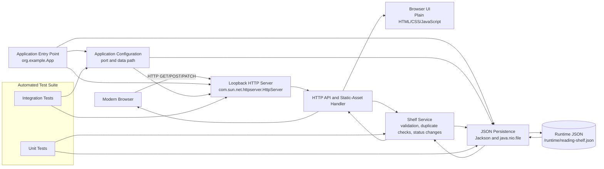

# Personal Reading Shelf Manager — Architecture

**Status:** Draft — awaiting explicit user approval

## 1. System Overview & Goals

The system is a lightweight, single-user local web application for SCRUM-193. It allows a reader to create shelf entries with title, author, and an allowed reading status; display the complete inventory; change statuses directly among all three states; persist the inventory across restarts; and receive clear action or validation feedback.

The design follows the approved `requirements.md` and only uses technologies listed in `.github/standards/TechStack.md`. It intentionally excludes authentication, network exposure, and features not defined by the approved requirements.

Primary quality goals are:

- local-only operation and simple startup;
- validated inventory changes persisted across restarts, with platform limits on crash durability stated explicitly;
- explicit persistence and startup failures;
- isolated automated testing;
- responsive use in a modern browser.

## 2. Requirements Traceability Matrix

| Requirement | Acceptance intent | Architecture component(s) |
|---|---|---|
| FR-01 — Create a book | Validate title, author, and one of the three statuses; reject empty or whitespace-only fields without adding the record. | Browser UI, HTTP API Handler, Shelf Service |
| FR-02 — Display complete inventory | Show every stored entry with title, author, and current status. | Browser UI, HTTP API Handler, Shelf Service, JSON Persistence |
| FR-03 — Change status | Change directly between any pair of distinct statuses and reflect the result. | Browser UI, HTTP API Handler, Shelf Service, JSON Persistence |
| FR-04 — Prevent duplicates | Reject same title-and-author pairs regardless of status. | Shelf Service, JSON Persistence, HTTP API Handler |
| FR-05 — Provide action feedback | Field-specific validation and visibly reflected successful creates/status changes. | Browser UI, HTTP API Handler, Shelf Service |
| FR-06 — Persist inventory | Save entries and status changes locally across restarts; report a platform-limited durability warning when parent-directory sync is unsupported. | Shelf Service, JSON Persistence, Application Configuration, HTTP API Handler, Browser UI |
| FR-07 — Start locally | Start through Maven and serve the browser UI at `http://127.0.0.1:8080/`. | Application Entry Point, HTTP Server, Browser UI, Maven Configuration |
| NFR-01 — Loopback-only binding | Bind only to `127.0.0.1`, never a wildcard or external interface. | Application Entry Point, HTTP Server, Application Configuration |
| NFR-02 — Persistence-error reporting | Malformed, unreadable, and unwritable persistence conditions are surfaced explicitly and never reported as successful load/save; unsupported parent-directory sync is reported as a platform-limited durability warning, while an actual sync I/O failure on a supported platform remains an error. | Application Entry Point, JSON Persistence, HTTP API Handler, Browser UI |
| NFR-03 — Responsive browser interface | Inventory and controls remain usable and not clipped or overlapped at wide and narrow viewports. | Browser UI |
| NFR-04 — Isolated automated tests | Persistence and server tests use injected temporary paths and ephemeral ports. | Application Configuration, Shelf Service, HTTP Server, Automated Test Suite |

## 3. Architecture Diagram



## 4. Key Components & Responsibilities

### Browser UI

- **Purpose:** Render inventory and collect create/status-change actions.
- **Inputs:** Inventory JSON and API success/error JSON; user title, author, and status selections.
- **Outputs:** HTML/CSS/JS assets, create/status-change requests, rendered inventory and field/action feedback.
- **Owned data:** No persistent data; transient form and render state only.
- **Serves:** FR-01, FR-02, FR-03, FR-05, NFR-03.
- **Error contract:** For API failures, consume the standardized `error` envelope in Section 5 and display its message and any field-specific errors as text.
- **Responsive smoke matrix:** Manually check the UI in a modern browser at both 1280 × 800 (wide) and 375 × 667 (narrow). At each viewport, check that the inventory, create controls, and status controls are visible and usable; add a book, change its status, and verify invalid title/author feedback. No inventory text or control may be clipped or overlapped. Vertical scrolling is acceptable; content must not require horizontal page scrolling to reach or use controls.

### Application Entry Point

- **Purpose:** Compose configuration, persistence, service, and loopback HTTP server, then start or fail clearly.
- **Inputs:** JVM process arguments, system properties, and runtime data path.
- **Outputs:** Bound server or explicit startup failure; initial inventory load.
- **Owned data:** Process lifecycle state only.
- **Serves:** FR-06, FR-07, NFR-01, NFR-02.
- **Exact entry point:** existing Maven property `org.example.App`; implementation updates this entry point as needed. Documented command: `.\mvnw.cmd compile exec:java` on Windows or `./mvnw compile exec:java` on Unix-like systems.

### Application Configuration

- **Purpose:** Supply injected settings while preserving the approved defaults.
- **Inputs:** default values and test/process configuration.
- **Outputs:** loopback host, port, and JSON path.
- **Owned data:** resolved configuration values.
- **Serves:** FR-06, FR-07, NFR-01, NFR-04.
- **Defaults:** port `8080`; host `127.0.0.1`; runtime JSON path `data/runtime/reading-shelf.json`, resolved relative to the Maven working directory/repository root.
- **Supported overrides:** JVM system property `reading.shelf.port` and JVM system property `reading.shelf.data.path`. Tests may instead pass constructor parameters to avoid process-global state.
- **Existing-data rule:** do not read, migrate, copy, or overwrite `data/reading-shelf.json`. The runtime file is a separate path under `data/runtime/`.

### HTTP Server

- **Purpose:** Listen only on loopback and host static assets and API routes.
- **Inputs:** inbound local HTTP requests and server configuration.
- **Outputs:** HTTP responses and clear bind failures.
- **Owned data:** no application data.
- **Serves:** FR-07, NFR-01, NFR-04.

### HTTP API and Static-Asset Handler

- **Purpose:** Define the browser-facing boundaries and translate service/persistence outcomes into HTTP responses.
- **Inputs:** HTTP methods, URL paths, JSON request bodies.
- **Outputs:** static HTML/CSS/JS or JSON inventory/error responses.
- **Owned data:** no persistent or domain data.
- **Serves:** FR-01 through FR-07, NFR-02.

### Shelf Service

- **Purpose:** Own shelf domain rules and orchestrate persistence.
- **Inputs:** create requests and status-change requests; current inventory.
- **Outputs:** resulting inventory, field validation errors, duplicate errors, status-change errors, or persistence errors.
- **Owned data:** a process-local inventory loaded from persistence.
- **Serves:** FR-01 through FR-06.
- **Mutation serialization:** Serialize each create and status-change operation under one service-level mutation lock. The critical section covers validation against current inventory (including duplicate/not-found checks), candidate snapshot construction, persistence save, and in-memory commit. A failed save does not commit the candidate. Inventory reads obtain a consistent snapshot under the same synchronization rule and return a snapshot rather than the mutable internal collection.

### JSON Persistence

- **Purpose:** Load and atomically save the inventory through Jackson and `java.nio.file`.
- **Inputs:** configured JSON path and inventory snapshots.
- **Outputs:** loaded inventory or explicit load/save failures.
- **Owned data:** reading of and writing to the runtime JSON file.
- **Serves:** FR-06, NFR-02, NFR-04.
- **I/O test seam:** Isolate the persistence operations that access/force files and replace the target behind a narrow injected Java interface. Production uses the approved Java NIO implementation; tests may inject deterministic failures for read, file flush, atomic replacement, and directory sync without relying on host permissions. JSON parsing/serialization remains Jackson behavior and can also be exercised with temporary files.

### Automated Test Suite

- **Purpose:** Verify domain rules, JSON behavior, HTTP behavior, loopback binding, and responsiveness-related browser contracts where executable.
- **Inputs:** temporary directories, ephemeral ports, test fixtures.
- **Outputs:** JUnit test results.
- **Owned data:** test-only temporary files and server state.
- **Serves:** NFR-04 and all acceptance criteria.
- **Persistence failure coverage:** Use the injected I/O seam to deterministically exercise read, file-flush, atomic-replace, platform-probe unsupported, and supported-platform directory-sync I/O failure outcomes. Verify the unsupported-probe path succeeds with an exposed warning after file flush and atomic replacement; verify an actual sync `IOException` after replacement on a supported platform is surfaced as a failure and enters the fail-closed state. Use temporary files to verify malformed JSON handling and candidate-state behavior.
- **Responsive smoke coverage:** Execute the manual two-viewport matrix defined under Browser UI (1280 × 800 and 375 × 667) in a modern browser, recording viewport, interactions, and clipping/overlap result. This is a smoke contract and does not add a browser automation framework.

## 5. Interfaces & Contracts

### Data Shape

The persisted document is an object containing the inventory:

- `books`: array
- Each book:
  - `title`: string
  - `author`: string
  - `status`: one of `To Read`, `Reading`, `Finished`

No extra inventory fields are exposed. Title and author are stored exactly as submitted after validation. Duplicate matching compares the stored title and author exactly; status is not part of the comparison.

### HTTP Static Route

- `GET /` → HTML entry page
- Static assets under `/web/...` → approved plain CSS/JavaScript or equivalent static paths
- Unknown asset/path → explicit `404` response

### HTTP API Routes

- `GET /api/books`
  - Success: `200` with `{"books":[...]}`
  - Failure: `500` with the standardized error envelope and code `PERSISTENCE_LOAD_ERROR`
  - If the service is in the post-replacement durability-uncertain state following an actual directory-sync `IOException` on a platform reported as supporting sync, return `500` with code `PERSISTENCE_ERROR` rather than serving a potentially stale in-memory inventory.
- `POST /api/books`
  - Request: `{"title":"...","author":"...","status":"To Read"}`
  - Valid success: `201` with the resulting book and inventory or success envelope; include `durabilityWarning` when the platform probe reports parent-directory sync unsupported.
  - Empty/whitespace title, empty/whitespace author, invalid status, or missing required field: `400` with the standardized error envelope and code `VALIDATION_ERROR`; `fieldErrors` identifies each invalid field.
  - Duplicate title and author: `409` with the standardized error envelope and code `DUPLICATE_BOOK`; `fieldErrors` identifies `title` and `author`.
  - Persistence failure: `500` with the standardized error envelope and code `PERSISTENCE_SAVE_ERROR`; no success response.
- `PATCH /api/books/status`
  - Request: `{"title":"...","author":"...","status":"Reading"}`
  - Valid success: `200` with the resulting book; include `durabilityWarning` when the platform probe reports parent-directory sync unsupported.
  - Unknown title-and-author pair: `404` with the standardized error envelope and code `BOOK_NOT_FOUND`.
  - Invalid status or missing identity fields: `400` with the standardized error envelope and code `VALIDATION_ERROR`; `fieldErrors` identifies invalid fields.
  - Persistence failure: `500` with the standardized error envelope and code `PERSISTENCE_SAVE_ERROR`; no success response.

Malformed JSON request bodies use `400` with the standardized error envelope and code `MALFORMED_JSON`. Unexpected API failures use `500` with code `INTERNAL_ERROR` and a non-sensitive generic message.

### HTTP Error Response Contract

Every API error uses the same JSON shape:

```json
{
  "error": {
    "code": "VALIDATION_ERROR",
    "message": "A concise, user-facing explanation.",
    "fieldErrors": {
      "title": "A field-specific explanation."
    }
  }
}
```

`code` is a stable machine-readable value; `message` is a concise user-facing string; `fieldErrors` is always an object and is empty when no field-specific errors apply. For multiple invalid fields, include one entry per field. Supported codes are `VALIDATION_ERROR`, `DUPLICATE_BOOK`, `BOOK_NOT_FOUND`, `MALFORMED_JSON`, `PERSISTENCE_LOAD_ERROR`, `PERSISTENCE_SAVE_ERROR`, `PERSISTENCE_ERROR` (the service cannot safely serve inventory after a durability-uncertain write), and `INTERNAL_ERROR`. The HTTP status codes remain as specified by the route contracts. Error responses never include stack traces, secrets, or internal file contents. The Browser UI uses `message` and `fieldErrors` without interpreting them as markup.

Successful create and status-change responses include an optional `durabilityWarning` string only when the platform probe reports parent-directory sync unsupported. The stable warning identifier is `PLATFORM_LIMITED_DURABILITY`; the user-facing explanation states that the temporary file was flushed and atomically replaced, but the platform cannot sync the parent directory and crash durability of the directory entry is therefore not guaranteed. The Browser UI displays this warning, and JSON Persistence records the outcome through the approved Java logging facility. Normal supported-and-synced success responses omit the warning.

### Shelf Service Interface

Conceptual operations:

- `loadInventory(path): InventorySnapshot`
- `createBook(title, author, status): CreateResult`
- `changeStatus(title, author, status): ChangeResult`
- `listBooks(): InventorySnapshot`

Errors are typed as:

- field validation errors;
- duplicate entry;
- book not found;
- persistence load error;
- persistence save error.

### Persistence Interface

- `load()`: read one JSON document, reject malformed JSON or unreadable file, and return no inventory on failure.
- `save(candidateSnapshot)`: probe parent-directory sync capability, serialize to a temporary file in the runtime directory, and flush the temporary file's contents and metadata with Java NIO `FileChannel.force(true)` before atomically replacing the runtime file. If the probe reports sync supported, sync the parent directory and report success only after that succeeds. If the probe specifically reports sync unsupported, skip the sync, report success after file flush and atomic replacement, and return/record the platform-limited durability warning defined above; do not claim full crash durability. A probe error other than an explicit unsupported result, file flush failure, or atomic replacement failure is a save failure. If replacement succeeds and directory sync then throws an actual `IOException` on a platform whose probe reported support, report save failure and enter the fail-closed persistence-error state described in Section 8. `UnsupportedOperationException` is treated as unsupported only when it is the explicit result of the platform capability probe; it does not by itself trigger fail-closed behavior. This operation creates the runtime data directory/file only when a save is possible and refuses to overwrite the existing `data/reading-shelf.json`.

## 6. Data Flow & Sequence Logic

### Main create flow

1. Browser validates that fields are present for immediate feedback, then submits `POST /api/books`.
2. HTTP handler decodes JSON and invokes Shelf Service.
3. Shelf Service acquires the mutation lock and keeps it through validation, candidate snapshot creation, persistence, and commit.
4. Shelf Service rejects missing/whitespace title or author separately and rejects unsupported status.
5. Shelf Service compares title-and-author exactly against the in-memory inventory and rejects duplicates.
6. Shelf Service creates a candidate inventory snapshot without mutating process state.
7. JSON Persistence flushes the temporary file and atomically replaces the runtime file. If the platform probe reports sync supported, it syncs the parent directory before success; if the probe reports unsupported, it returns success with the platform-limited durability warning and does not claim full crash durability.
8. Only after persistence reports success does Shelf Service commit the snapshot in memory and release the lock.
9. HTTP handler returns success; Browser updates the dashboard and displays any returned durability warning.

### Main status-change flow

1. Browser sends the entry title and author plus the selected status through `PATCH /api/books/status`.
2. HTTP handler validates the request shape and calls Shelf Service.
3. Shelf Service acquires the mutation lock and holds it through lookup, candidate creation, persistence, and commit.
4. Shelf Service finds the matching title-and-author entry and validates the status.
5. For a supported ordered status change, the selected status is validated against the three-status set. The architecture implements all six ordered changes between distinct statuses.
6. Shelf Service creates a candidate snapshot and persistence flushes the file and atomically replaces the runtime file; it syncs the parent directory if the platform probe reports support, otherwise it returns the platform-limited durability warning.
7. Only after persistence reports success does Shelf Service commit and release the lock; HTTP handler returns success.
8. Browser visibly displays the latest status and any returned durability warning.

### Initial load flow

1. Application Entry Point resolves loopback host, port, and runtime data path.
2. JSON Persistence loads `data/runtime/reading-shelf.json`.
3. If the file is absent, startup treats it as an empty inventory and does not create or modify `data/reading-shelf.json`.
4. If load succeeds, the process starts HttpServer.
5. If binding fails because port 8080 is occupied or an ephemeral test port cannot bind, startup reports the bind failure and exits; it does not try another port or claim success.

### Malformed persistence flow

1. JSON Persistence detects invalid JSON or an incompatible document shape.
2. It returns a load error containing a non-secret user-facing persistence reason.
3. Application Entry Point reports startup failure and does not start the HTTP server or overwrite the file.

### Unreadable persistence flow

1. JSON Persistence cannot read the runtime file.
2. It returns an explicit unreadable/load error.
3. Application Entry Point reports startup failure and does not present an empty or successfully loaded shelf.

### Unwritable persistence flow

1. Shelf Service creates a valid candidate snapshot.
2. JSON Persistence fails to flush/replace the runtime file, or the platform probe reports sync supported and the subsequent parent-directory sync throws `IOException`.
3. Shelf Service does not commit the candidate to process state.
4. If the atomic replacement already occurred before that supported-platform sync `IOException`, persistence enters a fail-closed error state: it rejects subsequent mutations and inventory reads, returning `PERSISTENCE_ERROR` for reads rather than serving a potentially stale snapshot. Restart and successful reload are required to resume service.
5. HTTP handler returns `500` with the standardized `PERSISTENCE_SAVE_ERROR` envelope.
6. Browser leaves the prior inventory visible and shows the error message.

### Parent-directory sync unsupported flow

1. Before replacement, JSON Persistence probes whether the current platform/provider supports syncing the parent directory.
2. The probe explicitly reports unsupported (including `UnsupportedOperationException` as the probe result); this is not treated as an operational sync failure.
3. JSON Persistence flushes the temporary file and atomically replaces the runtime file, then returns a successful persistence outcome with the `PLATFORM_LIMITED_DURABILITY` warning. It records the limitation and does not claim full crash durability.
4. Shelf Service commits the candidate; the HTTP success response includes `durabilityWarning`, and Browser UI displays it.

### Duplicate and validation flow

1. Create request reaches Shelf Service.
2. Whitespace title and whitespace author are reported as separate field errors where both are invalid.
3. Unsupported status is reported as a status error.
4. A title-and-author match, regardless of status, returns a duplicate conflict and leaves the inventory unchanged.
5. HTTP handler returns `400` or `409`; persistence is not called.

## 7. Technology Stack Selection

| Component / concern | Approved technology | Fit and justification | Requirement IDs | Standards Status |
|---|---|---|---|---|
| Runtime | Java 17 | Single local process, approved LTS runtime, and sufficient standard-library support. | FR-06, FR-07, NFR-01 | Approved |
| Build/startup | Maven 3.9+ and Maven Wrapper | Repository build, compiler configuration, and documented local command are approved. | FR-07, NFR-04 | Approved |
| Maven application launch | Exec Maven Plugin 3.5.0 | Existing pinned plugin starts `org.example.App` directly and is approved. | FR-07 | Approved |
| HTTP server | Java `com.sun.net.httpserver.HttpServer` | Minimal local server with loopback binding and test injection. | FR-07, NFR-01, NFR-04 | Approved |
| Browser UI | Plain HTML, CSS, JavaScript | Meets responsive browser delivery without an approved-framework dependency. | FR-02, FR-05, NFR-03 | Approved |
| JSON load/save | Jackson `jackson-databind` | Approved serializer/deserializer for a small local JSON document. | FR-06, NFR-02, NFR-04 | Approved |
| File I/O | Java `java.nio.file` | Approved standard library for path, directory, temp-file, and atomic replace operations. | FR-06, NFR-02, NFR-04 | Approved |
| Unit tests | JUnit 5 Jupiter | Approved test framework for domain and persistence units. | FR-01–FR-06, NFR-02, NFR-04 | Approved |
| Test doubles | Mockito Core/Jupiter | Approved for narrowly isolated dependencies where test doubles add value. | NFR-02, NFR-04 | Approved |
| Architecture diagram | Mermaid | Approved Markdown documentation format. | All design stages | Approved |

No additional library or plugin is selected.

## 8. Error Handling & Security Considerations

### Failure modes

| Failure | Required behavior |
|---|---|
| Empty/whitespace title | `400`; field-specific title error; no write |
| Empty/whitespace author | `400`; field-specific author error; no write |
| Unsupported status | `400`; status error; no write |
| Duplicate title and author | `409`; inventory unchanged; no write |
| Unknown status-change entry | `404`; no write |
| Malformed runtime JSON | Startup failure; explicit malformed-data message; file not overwritten |
| Unreadable runtime JSON | Startup failure; explicit unreadable-data message; file not overwritten |
| Unwritable runtime file/directory | Save HTTP `500`; in-memory state unchanged; explicit save-failure message |
| Port occupied | Startup failure; no fallback port, no claim of successful start |
| Unknown/static asset request | `404` |
| Malformed HTTP JSON | `400`; no domain mutation or persistence call |
| API validation, duplicate, not-found, malformed JSON, or persistence error | Standardized `{"error":{"code":...,"message":...,"fieldErrors":{...}}}` response; no stack traces or internal file contents |
| File flush or atomic replacement failure | Save HTTP `500`; candidate is not committed |
| Parent-directory sync unsupported in the explicit platform probe | After successful file flush and atomic replacement, report save success with recorded and exposed `PLATFORM_LIMITED_DURABILITY` warning; do not claim full crash durability and do not fail-close solely for `UnsupportedOperationException` |
| Parent-directory sync `IOException` after replacement when the probe reported support | Save HTTP `500`; do not claim durable success; fail closed against further mutations and inventory reads (`PERSISTENCE_ERROR`) until restart and successful reload |

### Persistence behavior

- Default runtime file: `data/runtime/reading-shelf.json`, outside `src/main/java`, `src/main/resources`, and test resources.
- Existing `data/reading-shelf.json` is not the runtime file and is never read or modified by this design.
- `data/` is already ignored by `.gitignore`, preventing runtime content from normal version control.
- A missing runtime file is treated as an empty shelf. A malformed or unreadable existing file is not treated as empty.
- Saves probe parent-directory sync capability before replacement, flush the temporary file with `FileChannel.force(true)`, and atomically replace the runtime file. If the probe reports support, parent-directory `FileChannel.force(true)` must succeed before save success is reported; an actual `IOException` after replacement causes save failure and the fail-closed persistence-error state, with candidate state uncommitted. If the probe explicitly reports unsupported, the save may succeed after file flush and atomic replacement; JSON Persistence records and returns `PLATFORM_LIMITED_DURABILITY`, the HTTP success response exposes the warning, and Browser UI displays it. This success does not claim full crash durability of the directory entry. An `UnsupportedOperationException` alone is not a reason to fail-close; only an explicit unsupported probe produces the platform-limited success path.
- Test paths and ports are injected; tests must not read or alter the existing runtime file or require port 8080.
- A narrow injected Java I/O interface lets tests deterministically force read, file-flush, replacement, and directory-sync errors. It introduces no library or runtime service beyond the approved Java standard library.

### Security and validation

- Bind `InetSocketAddress` only to `127.0.0.1`; do not bind to `0.0.0.0`.
- The application is single-user and loopback-only; authentication is not added.
- User text is validated for required non-whitespace values and exposed as text in the browser without interpreted markup.
- Status values are allow-listed.
- File and network configuration values are validated; unexpected values fail clearly rather than silently changing host or port.
- No credentials, tokens, API keys, or secrets are stored or logged.
- HTTP and persistence errors report operation-relevant messages without exposing secret or implementation data.

## 9. Assumptions, Risks & Open Questions

### Architecture decisions

- **Persistence location:** `data/runtime/reading-shelf.json` is chosen because it is outside source/resource directories, can be separated from the existing `data/reading-shelf.json`, and `data/` is already ignored by repository Git configuration.
- **Persistence failure policy:** malformed or unreadable data fails startup and is not replaced; unwritable data fails save explicitly and leaves the prior process inventory unchanged.
- **Domain identity:** title and author identify an entry for duplicate checks and status changes. A separate display ID is not added to the inventory JSON.
- **Duplicate equality:** exact stored title-and-author equality; no normalization of title or author beyond required non-whitespace validation is assumed.
- **HTTP method/style:** `GET`, `POST`, and `PATCH` routes are sufficient for the approved operations.
- **Missing runtime file:** represent as an empty inventory; this is distinct from malformed or unreadable existing data.

### Risks

- An exact-text duplicate decision is case-sensitive; any future case-insensitive requirement would require a decision and change.
- Runtime data under `data/` may be deleted or moved by the operator; explicit startup/load errors keep this visible rather than silently replacing malformed data.
- Filesystem support for forcing a directory can differ across operating systems. When the explicit platform probe reports unsupported, saves retain file-flush and atomic-replacement behavior but disclose the platform-limited crash-durability guarantee; when support is reported, successful directory sync remains a precondition for success and an actual sync `IOException` after replacement fails closed.
- A loopback-only server still accepts any local process as an HTTP client; out-of-scope authentication remains excluded.
- Responsive behavior is checked against the explicit manual viewport smoke matrix under Browser UI; this does not add an unapproved browser testing dependency.

### Open questions

- None identified. The requirements contain no unresolved scope, status-transition, duplicate, persistence-location, or persistence-error behavior gaps. The path and recovery policy above are architecture decisions permitted by the approved requirements and TechStack.

## 10. Change Log

| Date | Finding ID | Architecture change |
|---|---|---|
| 2026-11-24 | F-01 | Defined a service-level mutation lock covering validation, candidate construction, persistence, and commit for create/status changes; synchronized consistent inventory snapshots. |
| 2026-11-24 | F-02 | CR-01: Preserved parent-directory sync as a success precondition when the platform probe reports support; when the probe explicitly reports unsupported, allow success after temporary-file flush and atomic replacement, record and expose `PLATFORM_LIMITED_DURABILITY` without claiming full crash durability or fail-closing solely for `UnsupportedOperationException`; preserve save failure and fail-closed behavior for an actual post-replacement directory-sync `IOException` on a supported platform. Updated FR-06/NFR-02 traceability and persistence contracts/flows accordingly. |
| 2026-11-24 | F-03 | Added an injected Java I/O test seam and deterministic persistence failure coverage using approved Java APIs and JUnit/Mockito. |
| 2026-11-24 | F-04 | Defined a manual modern-browser smoke matrix at 1280 × 800 and 375 × 667 with required create, status-change, validation, and no-clipping/no-overlap checks. |
| 2026-11-24 | F-05 | Standardized API errors on a stable `error` envelope with `code`, `message`, and always-present `fieldErrors`; documented codes, response mapping, and safe rendering. |
