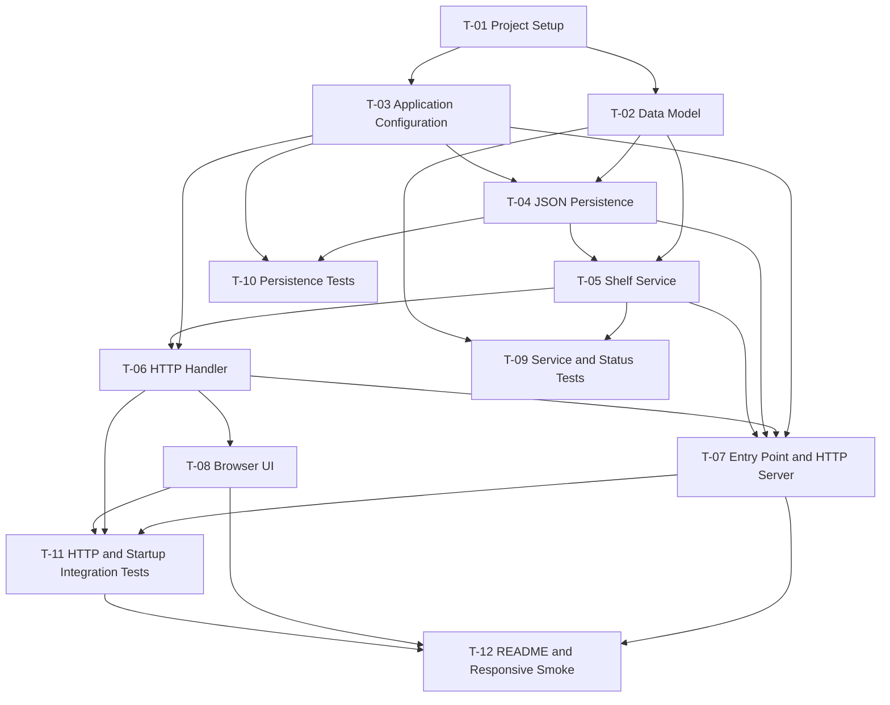

# 1. Overview & Implementation Strategy

**Planning status:** Draft — awaiting explicit user approval. No implementation work or production-code changes are included in this plan.

The implementation will be built from a Maven/Java 17 foundation, then the domain model, injected configuration, durable Jackson persistence, synchronized shelf service, HTTP/UI boundaries, and runnable entry point. Integration and smoke verification follow the production implementation.

The task order prevents circular or forward dependencies: T-01 establishes the approved build; T-02 and T-03 establish immutable model/configuration types; T-04 adds persistence and its I/O seam; T-05 owns serialized domain mutations; T-06 maps HTTP contracts; T-07 composes and binds the loopback server; T-08 supplies browser assets; T-09–T-11 verify behavior and failures; and T-12 updates startup documentation and records the manual smoke check. The plan contains **12 tasks**.

# 2. Dependency Graph

# 3. Task Order Summary

| Task ID | Description | Status |
|---|---|---|
| T-01 | Configure Java 17 Maven project, layout, test plugins, dependencies, and Exec entry point. | `[x]` Done |
| T-02 | Implement book data shape and status allow-list. | `[x]` Done |
| T-03 | Implement application configuration defaults and overrides. | `[x]` Done |
| T-04 | Implement injected I/O seam and durable Jackson persistence. | `[x]` Done |
| T-05 | Implement synchronized shelf validation and mutation service. | `[x]` Done |
| T-06 | Implement static/API HTTP routing and standardized error envelope. | `[x]` Done |
| T-07 | Implement loopback server composition and explicit startup entry point. | `[x]` Done |
| T-08 | Implement plain responsive HTML, CSS, and JavaScript UI. | `[x]` Done |
| T-09 | Test create, inventory, status transitions, duplicate, and feedback domain behavior. | `[x]` Done |
| T-10 | Test temporary-path persistence and all deterministic I/O failures. | `[x]` Done |
| T-11 | Test HTTP API, ephemeral-port server, loopback binding, and startup failures. | `[x]` Done |
| T-12 | Document exact start command/URL/persistence path and perform two-viewport smoke check. | `[x]` Done |

# 4. Detailed Task Breakdown

## T-01 — Project Setup

- **Status:** `[x]` Done
- **Description:** Establish the Maven Wrapper build and Java 17 project layout. Configure `org.example.App` as the Exec entry point, Java release 17, JUnit 5/Jupiter, Surefire, Mockito, Jackson, and the Exec Maven Plugin. Replace any starter-only behavior only as required to support the approved application.
- **Dependencies:** None
- **Requirement IDs:** Setup
- **Architecture component:** Maven Configuration; Application Entry Point
- **Production files:** `pom.xml`; `src/main/java/org/example/App.java` (entry-point scaffold update)
- **Test files:** `src/test/java/org/example/AppTest.java`
- **Maven dependencies with pinned versions:**
  - `com.fasterxml.jackson.core:jackson-databind:2.22.4`
  - `org.junit.jupiter:junit-jupiter:5.14.4`
  - `org.mockito:mockito-core:5.24.0`
  - `org.mockito:mockito-junit-jupiter:5.24.0`
  - `org.apache.maven.plugins:maven-compiler-plugin:3.15.0`
  - `org.apache.maven.plugins:maven-surefire-plugin:3.6.1`
  - `org.codehaus.mojo:exec-maven-plugin:3.5.0`
- **Acceptance criteria:** Maven uses Java 17; standard layout exists; all dependencies and plugins are approved/pinned; Exec is configured for `org.example.App`; the starter test compiles and test naming remains `*Test.java`.
- **Implementation note:** Removed starter console output and verified the entry point with a JUnit test. Existing `pom.xml` already satisfied the approved Java 17, pinned dependency/plugin, and Exec configuration; no build-file changes were needed.

## T-02 — Data Model

- **Status:** `[x]` Done
- **Description:** Implement the persisted and API book shape plus the exact three-value status allow-list. Preserve submitted title/author text after validation and avoid exposing extra fields.
- **Dependencies:** T-01
- **Requirement IDs:** FR-01, FR-02, FR-03, FR-04
- **Architecture component:** Browser UI data contract; Shelf Service
- **Production files (1–2 classes):**
  - `src/main/java/org/example/reading/shelf/Book.java`
  - `src/main/java/org/example/reading/shelf/ReadingStatus.java`
- **Test files:** `src/test/java/org/example/reading/shelf/BookTest.java`; `src/test/java/org/example/reading/shelf/ReadingStatusTest.java`
- **Maven dependencies with pinned versions:** None beyond T-01 build dependencies.
- **Acceptance criteria:** A book contains title, author, and one supported status; title/author whitespace validation is available; all six ordered distinct status transitions are representable; unsupported status is rejected; test names use `*Test.java`.
- **Implementation note:** Implemented immutable `Book` data shape with title/author whitespace validation and status-change copy support; implemented the three-value `ReadingStatus` allow-list with JSON and string parsing. Added JUnit 5 model tests for fields, validation, transitions, and unsupported status. No dependencies or `pom.xml` changes.
- **Correction note:** 2026-11-24 — Restricted status parsing to exact API labels `To Read`, `Reading`, and `Finished`; removed case-insensitive, whitespace-trimming, and enum-name variants. Added variant-rejection tests. Maven test run passes 11 tests.

## T-03 — Application Configuration

- **Status:** `[x]` Done
- **Description:** Implement loopback host, port, runtime JSON path resolution, JVM property overrides, and test-constructor injection. Defaults are `127.0.0.1`, `8080`, and `data/runtime/reading-shelf.json` relative to the repository working directory.
- **Dependencies:** T-01
- **Requirement IDs:** FR-06, FR-07, NFR-01, NFR-04
- **Architecture component:** Application Configuration
- **Production files (1 class):** `src/main/java/org/example/reading/config/ReadingShelfConfig.java`
- **Test files:** `src/test/java/org/example/reading/config/ReadingShelfConfigTest.java`
- **Maven dependencies with pinned versions:** None
- **Acceptance criteria:** Defaults resolve exactly; `reading.shelf.port` and `reading.shelf.data.path` are honored only for valid values; loopback host is fixed to `127.0.0.1`; test constructor parameters avoid process-global state; `data/reading-shelf.json` is never selected.
- **Implementation note:** Implemented fixed loopback host, validated port/data-path defaults and overrides, test-constructor injection, and legacy-path rejection. Added six JUnit 5 configuration tests; no dependencies or build-file changes. Maven test run passes 17 tests.
- **Correction note:** 2026-11-24 — Invalid JVM port/data-path properties now throw clear errors instead of falling back; resolved default, override, and test data paths are absolute and normalized. Legacy paths remain rejected.

## T-04 — Durable JSON Persistence

- **Status:** `[x]` Done
- **Description:** Implement a narrow injected Java I/O interface and Jackson/`java.nio.file` persistence. Load missing runtime files as empty, reject malformed/unreadable files, save via temporary file, `FileChannel.force(true)`, atomic replace, and parent-directory sync. Implement fail-closed state after post-replacement directory-sync failure.
- **Dependencies:** T-02, T-03
- **Requirement IDs:** FR-06, NFR-02, NFR-04
- **Architecture component:** JSON Persistence
- **Production files (2 classes):**
  - `src/main/java/org/example/reading/persistence/ReadingShelfIo.java`
  - `src/main/java/org/example/reading/persistence/JsonReadingShelfPersistence.java`
- **Test files:** `src/test/java/org/example/reading/persistence/JsonReadingShelfPersistenceTest.java`
- **Maven dependencies with pinned versions:**
  - `com.fasterxml.jackson.core:jackson-databind:2.22.4`
- **Acceptance criteria:** Runtime path is `data/runtime/reading-shelf.json` by default; missing file means empty; malformed/unreadable load fails explicitly and is not overwritten; save flushes, replaces, and syncs the parent directory; failures do not claim success; post-replacement directory-sync failure enters fail-closed persistence error; tests use temporary paths and the injected I/O seam.
- **Implementation note:** Implemented `ReadingShelfIo` with a narrow Java NIO seam and `JsonReadingShelfPersistence` with missing-file handling, Jackson document validation, forced temporary-file flush, atomic replacement, parent-directory sync, explicit load/save failures, and post-replacement fail-closed state. Added 11 JUnit 5 persistence tests covering missing/malformed/unreadable files, round trips, flush/replacement/directory-sync failures, and fail-closed reads/mutations. No dependencies or build-file changes. Maven test run passes 28 tests.
- **Correction note:** 2026-11-24 — Enabled Jackson `FAIL_ON_UNKNOWN_PROPERTIES`; unknown runtime JSON fields now fail explicitly and are not overwritten. Added a targeted test. Maven test run passes 29 tests.

## T-05 — Shelf Service

- **Status:** `[x]` Done
- **Description:** Implement the domain owner with a mutation lock spanning validation, duplicate/not-found lookup, candidate snapshot creation, persistence save, and in-memory commit. Inventory reads use the same synchronization rule and return snapshots.
- **Dependencies:** T-02, T-04
- **Requirement IDs:** FR-01, FR-02, FR-03, FR-04, FR-05, FR-06
- **Architecture component:** Shelf Service
- **Production files (1 class):** `src/main/java/org/example/reading/service/ShelfService.java`
- **Test files:** `src/test/java/org/example/reading/service/ShelfServiceTest.java`
- **Maven dependencies with pinned versions:** None beyond T-01 build dependencies.
- **Acceptance criteria:** Empty/whitespace fields yield separate field errors; duplicate identity is exact title+author and ignores status; all distinct status transitions and reversal to prior statuses work; failed persistence never commits a candidate; reads return consistent snapshots; concurrent mutations do not lose updates; F-01 serialization is represented in the implementation.
- **Implementation note:** Implemented synchronized `ShelfService` with separate title/author/status validation, exact duplicate and not-found lookup, immutable inventory snapshots, candidate persistence before in-memory commit, fail-closed reads/mutations, and enum/string status overloads. Added 10 JUnit 5/Mockito tests covering field errors, status transitions, duplicate/not-found behavior, failed-save non-commit, immutable reads, fail-closed persistence, and concurrent mutations. No dependencies or build-file changes. Maven test run passes 39 tests.
- **Correction note:** 2026-11-24 — Same-status changes now return the existing book without persistence. Added a no-op test. Maven test run passes 40 tests.

## T-06 — HTTP API and Static Handler

- **Status:** `[x]` Done
- **Description:** Implement `GET /`, static asset handling, `GET /api/books`, `POST /api/books`, and `PATCH /api/books/status`. Return the standardized envelope for every API error and never expose stack traces or internal file contents.
- **Dependencies:** T-03, T-05
- **Requirement IDs:** FR-01, FR-02, FR-03, FR-04, FR-05, FR-07
- **Architecture component:** HTTP API and Static-Asset Handler
- **Production files (1 class):** `src/main/java/org/example/reading/http/ReadingShelfHandler.java`
- **Test files:** `src/test/java/org/example/reading/http/ReadingShelfHandlerTest.java`
- **Maven dependencies with pinned versions:**
  - `com.fasterxml.jackson.core:jackson-databind:2.22.4`
- **Acceptance criteria:** Success/status mappings match architecture routes; malformed JSON uses `MALFORMED_JSON` with `400`; validation/duplicate/not-found/persistence/internal failures use the exact stable envelope; `fieldErrors` is always present; unknown assets return `404`; F-05 envelope mitigation is implemented and verified.
- **Implementation note:** Implemented `ReadingShelfHandler` with static classpath routing, JSON inventory/create/status routes, HTTP status mappings, and the standardized F-05 error envelope with always-present `fieldErrors`. Added 9 `ReadingShelfHandlerTest` JUnit 5 tests using an ephemeral loopback HTTP server. No dependencies or build-file changes. Maven test run passes 49 tests.

## T-07 — Entry Point and Loopback HTTP Server

- **Status:** `[x]` Done
- **Description:** Update `org.example.App` to compose configuration, persistence, service, and handler, load the inventory, bind `com.sun.net.httpserver.HttpServer` only to `127.0.0.1`, and fail clearly on malformed/unreadable load or occupied/failed bind.
- **Dependencies:** T-03, T-04, T-05, T-06
- **Requirement IDs:** FR-06, FR-07, NFR-01, NFR-02, NFR-04
- **Architecture component:** Application Entry Point; HTTP Server
- **Production files (2 classes):**
  - `src/main/java/org/example/App.java`
  - `src/main/java/org/example/reading/http/ReadingShelfHttpServer.java`
- **Test files:** `src/test/java/org/example/AppTest.java`; `src/test/java/org/example/reading/http/ReadingShelfHttpServerIntegrationTest.java`
- **Maven dependencies with pinned versions:**
  - `org.codehaus.mojo:exec-maven-plugin:3.5.0`
- **Acceptance criteria:** Default listener is `127.0.0.1:8080`; no fallback port or wildcard binding occurs; occupied port exits with clear failure; ephemeral test port works; malformed/unreadable persistence prevents server start and file overwrite; F-02 startup/durability behavior is honored.
- **Implementation note:** Implemented `App` startup composition and `ReadingShelfHttpServer` loopback binding with explicit load/bind failures. Added `ReadingShelfHttpServerIntegrationTest` for ephemeral loopback startup, malformed-JSON startup rejection, and occupied-port failure. Existing `AppTest` remained unchanged. No dependencies or build-file changes. `./mvnw.cmd test` passes 52 tests with 0 failures and 0 errors.

## T-08 — Browser UI

- **Status:** `[x]` Done
- **Description:** Create the plain responsive inventory dashboard and create/status controls. Render API `message` and `fieldErrors` as text and visibly reflect successful create/status changes.
- **Dependencies:** T-06
- **Requirement IDs:** FR-01, FR-02, FR-03, FR-05, NFR-03
- **Architecture component:** Browser UI
- **Production files (assets, no Java production classes):**
  - `src/main/resources/web/index.html`
  - `src/main/resources/web/styles.css`
  - `src/main/resources/web/app.js`
- **Test files:** `src/test/java/org/example/reading/http/BrowserContractIntegrationTest.java`
- **Maven dependencies with pinned versions:** None
- **Acceptance criteria:** Complete inventory displays title, author, and status; create/status controls are usable; validation and action feedback are text and field-specific; browser assets have no framework dependency; assets integrate with the static route.
- **Implementation note:** Implemented the responsive plain HTML/CSS/JavaScript inventory dashboard, create form, status controls, safe text rendering, field/action feedback, and static-route integration. Added `BrowserContractIntegrationTest` with ephemeral-loopback checks for the HTML shell, JavaScript API/action contract, text rendering, and responsive CSS. No dependencies or build, server, or production-handler changes. `.\mvnw.cmd test` passes 55 tests with 0 failures and 0 errors.

## T-09 — Domain Behavior Tests

- **Status:** `[x]` Done
- **Description:** Add isolated JUnit/Mockito coverage for model, validation, duplicate, inventory, direct status transitions, and persistence-commit behavior.
- **Dependencies:** T-02, T-05
- **Requirement IDs:** FR-01, FR-02, FR-03, FR-04, FR-05, FR-06
- **Architecture component:** Automated Test Suite; Shelf Service
- **Production files:** None
- **Test files:** `src/test/java/org/example/reading/service/ShelfServiceTest.java` (detailed unit coverage); `src/test/java/org/example/reading/shelf/ReadingShelfModelTest.java`
- **Maven dependencies with pinned versions:**
  - `org.junit.jupiter:junit-jupiter:5.14.4`
  - `org.mockito:mockito-core:5.24.0`
  - `org.mockito:mockito-junit-jupiter:5.24.0`
- **Acceptance criteria:** Both invalid fields, duplicate status independence, every one-way pair of distinct statuses, reversals, complete inventory, and failed-save non-commit are asserted; tests use `*Test.java` and requirement IDs in relevant `@DisplayName` values.
- **Implementation note:** Test-only: expanded `ShelfServiceTest` with duplicate inventory invariants and failed status-change save non-commit assertions. Existing `BookTest` and `ReadingStatusTest` model coverage is sufficient, so `ReadingShelfModelTest.java` was not added. No production code, build file, README, or T-10 work changed. `.\mvnw.cmd test` passes 56 tests with 0 failures and 0 errors.

## T-10 — Persistence Failure and Isolation Tests

- **Status:** `[x]` Done
- **Description:** Use temporary directories and deterministic injected I/O failures to cover malformed, unreadable, unwritable, file-flush, replacement, directory-sync, and post-replacement fail-closed behavior without touching runtime or `data/reading-shelf.json`.
- **Dependencies:** T-03, T-04
- **Requirement IDs:** FR-06, NFR-02, NFR-04
- **Architecture component:** JSON Persistence; Automated Test Suite
- **Production files:** None
- **Test files:** `src/test/java/org/example/reading/persistence/JsonReadingShelfPersistenceIntegrationTest.java`
- **Maven dependencies with pinned versions:**
  - `com.fasterxml.jackson.core:jackson-databind:2.22.4`
  - `org.junit.jupiter:junit-jupiter:5.14.4`
  - `org.mockito:mockito-core:5.24.0`
  - `org.mockito:mockito-junit-jupiter:5.24.0`
- **Acceptance criteria:** Temporary path tests never read or modify the user's runtime file; malformed/unreadable load surfaces explicit errors; read/flush/replacement/directory-sync failures are deterministic; candidate state is not committed; post-replacement sync failure returns persistence error for reads and refuses mutations; F-02 and F-03 are verified.
- **Implementation note:** Test-only: added `JsonReadingShelfPersistenceIntegrationTest.java` with temporary-path round-trip/isolation, malformed and unreadable load failures, deterministic unwritable, flush, replacement, and directory-sync failures, candidate non-commit assertions, and post-replacement fail-closed read/mutation refusal. No production code, build file, README, UI, or T-11 work changed. `.\mvnw.cmd test` passes 63 tests with 0 failures and 0 errors.

## T-11 — HTTP and Startup Integration Tests

- **Status:** `[x]` Done
- **Description:** Start the application using an ephemeral port and temporary data path, verify static/API behavior, loopback binding, startup failures, and all HTTP error mappings.
- **Dependencies:** T-07, T-08
- **Requirement IDs:** FR-01, FR-02, FR-03, FR-04, FR-05, FR-06, FR-07, NFR-01, NFR-02, NFR-04
- **Architecture component:** HTTP Server; HTTP API Handler; Automated Test Suite
- **Production files:** None
- **Test files:** `src/test/java/org/example/reading/http/ReadingShelfIntegrationTest.java`
- **Maven dependencies with pinned versions:**
  - `com.fasterxml.jackson.core:jackson-databind:2.22.4`
  - `org.junit.jupiter:junit-jupiter:5.14.4`
- **Acceptance criteria:** Integration tests use injected ephemeral ports/temp paths and do not require port 8080 or runtime user data; listener address is `127.0.0.1`; create/list/status/duplicate/validation/persistence-error flows and standardized JSON are verified; occupied bind and malformed/unreadable startup fail clearly; test is named `*IntegrationTest.java` with requirement IDs in `@DisplayName`.
- **Implementation note:** Test-only: added `ReadingShelfIntegrationTest.java` with ephemeral-loopback startup/static/API coverage, temporary persistence and restart checks, create/list/status/duplicate/validation/error-envelope assertions, deterministic save and unreadable-data failures, and occupied-port startup failure coverage. No production code, build file, README, UI, or T-12 work changed. `.\mvnw.cmd test` passes 69 tests with 0 failures and 0 errors.

## T-12 — README and Responsive Smoke

- **Status:** `[x]` Done
- **Description:** Replace the scaffold README with the exact Windows/Unix startup commands, browser URL, persistence path, data-exclusion rule, and a concrete two-viewport manual smoke procedure. Record the smoke result only after implementation verification.
- **Dependencies:** T-07, T-08, T-11
- **Requirement IDs:** FR-06, FR-07, NFR-01, NFR-03, NFR-04
- **Architecture component:** Application Entry Point; Browser UI; Documentation
- **Production files:** `README.md`
- **Test files:** No automated file added; existing integration and unit coverage remain under `src/test/java/`
- **Maven dependencies with pinned versions:** None
- **Acceptance criteria:** README contains exactly `.\mvnw.cmd compile exec:java` for Windows or `./mvnw compile exec:java` for Unix and `http://127.0.0.1:8080/`; README states the runtime persistence path `data/runtime/reading-shelf.json` and that `data/reading-shelf.json` is untouched; modern-browser smoke runs at `1280 × 800` and `375 × 667`, with inventory, create, status change, invalid-field feedback, no clipping/overlap, and no required horizontal page scrolling; F-04 mitigation is documented and checked.
- **Implementation note:** Replaced the scaffold README with SCRUM-193 startup, persistence, test, and two-viewport responsive smoke documentation. Documented the Windows and Unix commands, loopback URL, runtime/legacy data paths, data exclusion, verify commands, and manual smoke procedure. No production code, test, pom, UI, or later task files changed.

# 5. Blocked Tasks & Risks

- **T-01:** No external blocker.
- **T-02:** `[ ]` Open; blocked only on T-01 at implementation time.
- **T-03:** `[x]` Done; implemented loopback host, validated overrides, and test-constructor injection.
- **T-04:** `[x]` Done; implemented durable JSON persistence.
- **T-05:** `[x]` Done; implemented after T-02 and T-04.
- **T-06:** `[x]` Done; implemented after T-03 and T-05.
- **T-07:** `[x]` Done; dependencies T-03, T-04, T-05, and T-06 completed.
- **T-08:** `[x]` Done; implemented after T-06.
- **T-09:** `[x]` Done; test-only coverage completed after T-02 and T-05.
- **T-10:** `[x]` Done; test-only persistence coverage completed after T-03 and T-04.
- **T-11:** `[x]` Done; test-only HTTP/startup integration coverage completed after T-07 and T-08.
- **T-12:** `[x]` Done; README and responsive smoke procedure completed after T-07, T-08, and T-11.

The five mitigated design-review findings remain task constraints, not accepted risks:

- **F-01 — Concurrent mutations:** Mitigated by T-05's service-level mutation lock and consistent synchronized reads; verified by T-09.
- **F-02 — Crash durability:** Mitigated by T-04's file force, atomic replacement, parent-directory sync, and post-replacement fail-closed state; verified by T-10 and startup behavior in T-07.
- **F-03 — Persistence testability:** Mitigated by T-04's narrow injected I/O seam and T-10's deterministic temporary-path failure tests.
- **F-04 — Responsiveness smoke:** Mitigated by T-08 assets and T-12's exact `1280 × 800` and `375 × 667` matrix.
- **F-05 — HTTP contract:** Mitigated by T-06's stable envelope and T-11's HTTP integration assertions.

No design-review risk is accepted. No task depends on an external API, scope decision, or technology outside `TechStack.md`.

# 6. Requirements Coverage

| Requirement | Planned tasks | Coverage |
|---|---|---|
| FR-01 — Create a book | T-02, T-05, T-06, T-08, T-09, T-11 | Validation, exact status allow-list, create API/UI, and integration assertions |
| FR-02 — Display complete inventory | T-02, T-05, T-06, T-08, T-09, T-11 | Stored data shape, list operation, dashboard rendering, and API tests |
| FR-03 — Change a book's status | T-02, T-05, T-06, T-08, T-09, T-11 | Direct changes among all three statuses, including reversals |
| FR-04 — Prevent duplicate inventory entries | T-02, T-05, T-06, T-09, T-11 | Exact title+author matching independent of status and conflict response |
| FR-05 — Provide action feedback | T-05, T-06, T-08, T-09, T-11 | Field-specific validation and visible create/status feedback through the F-05 envelope |
| FR-06 — Persist inventory and status changes | T-03, T-04, T-05, T-07, T-09, T-10, T-11, T-12 | Runtime path, durable persistence, restart availability, and isolated persistence tests |
| FR-07 — Start and access locally | T-01, T-03, T-06, T-07, T-11, T-12 | Maven Exec startup, loopback HTTP server, exact URL, and README command |
| NFR-01 — Local-only network binding | T-03, T-07, T-11, T-12 | Fixed `127.0.0.1` binding and no fallback/wildcard binding |
| NFR-02 — Explicit persistence-error reporting | T-04, T-05, T-06, T-07, T-10, T-11 | Startup/load/save failures, standardized envelope, fail-closed behavior |
| NFR-03 — Responsive browser interface | T-08, T-12 | Two-viewport manual smoke matrix and visible/usable controls |
| NFR-04 — Isolated automated tests | T-03, T-04, T-07, T-10, T-11, T-12 | Injected temp path and ephemeral port, no runtime file or port 8080 dependency |

**Plan validation:** 11/11 FR-xx/NFR-xx requirements are mapped to at least one task. Test files follow `*Test.java` or `*IntegrationTest.java`. Every Maven dependency/plugin is approved in `TechStack.md` and explicitly pinned. No forward dependencies exist. The only current handoff status is draft/pending explicit approval; it becomes "Ready for Implementation" only after the user approves this plan.
